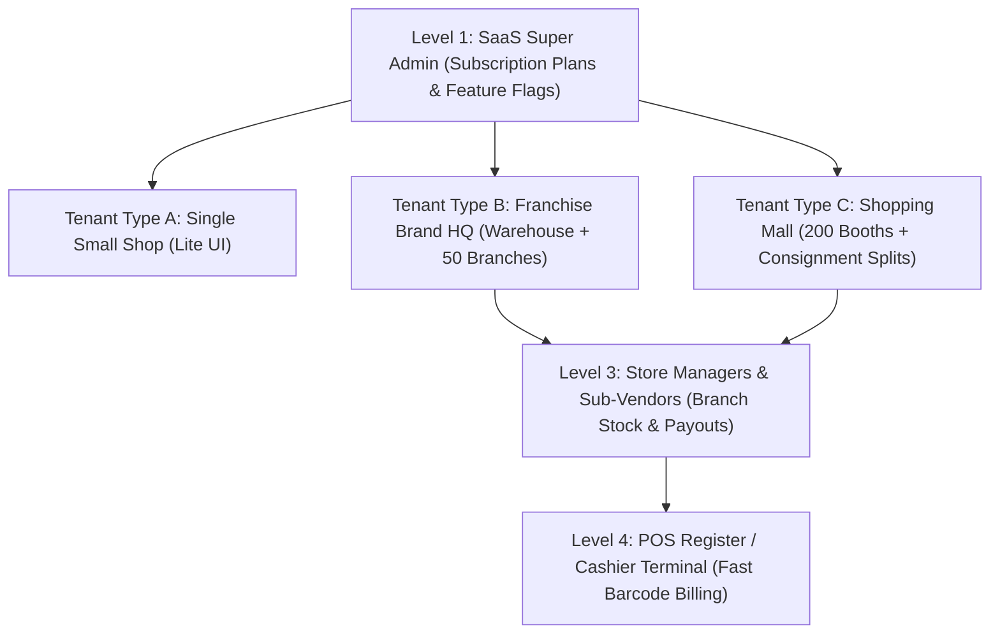

# ⚡ Universal Multi-Tenant Cloud POS, Franchise & Multi-Vendor Mall ERP

> **Ek Mukammal Online + Offline-First Point of Sale System:** Choti Karyana Dukan se le kar Franchise Chains, Department Stores, aur Multi-Vendor Shopping Malls tak ka End-to-End Enterprise Solution.

Built strictly according to the **12-Page Master System Architecture & Technical Blueprint**.

[](https://github.com/Malik-Hassam-Ullah/Point-Of-Sale-System-)
[](https://supabase.com)
[](#)
[](#)

---

## 🌟 Executive Overview & Core Vision

A single unified software engine capable of adapting to businesses of any scale through a **Modular Feature-Flag Architecture**:
- When a neighborhood grocery shop logs in, they experience an **ultra-clean, simple 1-screen billing terminal** with loose items and an Udhaar Khata book.
- When a Mega Shopping Mall or Multi-Branch Franchise CEO logs in, they gain access to a **Central Distribution Warehouse, Inter-Branch 4-Stage Stock Transfers, Consignment Vendor Split Portals, and a 5% Franchise Royalty Engine**.

---

## 🏗️ 4-Tier Multi-Tenant Hierarchy



1. **Level 1 — SaaS Super Admin**: Tenant provisioning, subscription management (Starter, Standard, Franchise Pro, Enterprise Mall), modular feature-flag toggling, and global cluster health.
2. **Level 2 — Tenant / Organization HQ**: Multi-branch live sales consolidation, central warehouse inventory, consolidated P&L, and franchise royalty receivables.
3. **Level 3 — Branch Manager & Vendor Self-Service Portal**: Local stock management, cashier shift approvals, vendor consignment sales breakdown, and fortnightly payout sheets.
4. **Level 4 — POS Register / Cashier Terminal**: High-speed mouse-free keyboard billing, barcode scanning, shift cash drawer tracking, and return processing.

---

## 🚀 6 Adaptive Business Modes

The system automatically transforms its user interface and active modules based on the selected **Business Mode**:

| Business Mode | Target Businesses | Key Specialized Modules |
| :--- | :--- | :--- |
| **1. Micro-Retail (Lite Mode)** | Karyana Store, Pan Shop, Mobile Shop, Bakery | 1-Screen billing, Khula Saman quick buttons (Cheeni, Daal, Atta), Daily Galla, Udhaar Khata with WhatsApp reminder. |
| **2. Supermarket & Cash & Carry** | Marts, Departmental Stores, Grocery Chains | Dual barcode scanning, Electronic Weighing Scale (Prefix 20/21) auto-parser, Carton vs. piece pricing, multi-tab hold/recall bills. |
| **3. Fashion, Garments & Shoes** | Boutiques, Clothing Franchises, Shoe Stores | Matrix Inventory (Size × Color × Style), built-in Thermal Barcode Sticker Designer, Salesman commission tracking. |
| **4. Pharmacy & Medical Store** | Clinics, Chain Pharmacies, Chemist Stores | **First-Expiry First-Out (FEFO)** batch auto-selection, Generic/Salt formula lookup, Box-to-Strip-to-Tablet conversion calculator. |
| **5. Restaurant & Food Court** | Fast Food, Fine Dining, Cafes, Bakeries | Interactive Floor Table Mapping (T1–T6), Dine-In/Takeaway modes, KOT (Kitchen Order Ticket) routing, BOM recipe raw material deduction. |
| **6. Multi-Vendor Mall & Franchise** | Shopping Malls, Consignment Stores, Chains | Central Checkout Consignment Splits, automated vendor commission deduction, Vendor Self-Service Portal, Franchise Royalty (5% + 2% Marketing Fee). |

---

## ⚡ High-Speed Cashier Screen & Hardware

- **100% Mouse-Free Keyboard Shortcuts**:
  - `F1`: Focus fast barcode scanner & search input
  - `F2`: Instant item quantity change
  - `F4`: Hold / Park current bill (supports up to 5 parallel customer tickets)
  - `F8`: Sub-second Cash Checkout with cash drawer kick sound
  - `F9`: Split Payment modal (Cash + Visa/Mastercard + JazzCash/EasyPaisa/Raast)
  - `Esc`: Clear / cancel current cart
- **Electronic Weighing Scale Barcode Parser**:
  - Automatically parses Prefix-20 and Prefix-21 weight-embedded barcodes (e.g. `20000401250` auto-resolves to Item `0004` weighing `1.250 kg`).
- **Pakistan Localized Compliance & FBR POS**:
  - Official FBR POS Invoice Number generation (`FBR-YYYY-POSID-XXXXXX`)
  - Verifiable self-contained **FBR QR Code** printed on thermal receipts.
- **Thermal Printer Engine (80mm & 58mm ESC/POS)**:
  - Pixel-perfect receipt rendering with print media rules, silent print support, and 1-click **WhatsApp Digital Invoice** sharing.
- **Customer-Facing Dual Display**:
  - Live customer pole display synchronization for 2nd screen / customer monitors.

---

## 🌐 Offline-First Engine & Cloud Synchronization

- **Zero-Latency Scanning (<10ms)**: Catalog cached locally in memory and IndexedDB.
- **Background Sync Outbox Queue**: Invoices generated during internet disconnection queue up in `sync_outbox` and automatically push to Supabase PostgreSQL when connection resumes.
- **Power Failure Protection**: Live cart state persistence ensures no items are lost if the computer reboots or the browser refreshes.
- **Conflict-Free Invoice IDs**: Format `BR01-POS1-YYYYMMDD-XXXX` guarantees zero collisions across offline registers.

---

## 💼 Accounting, Blind Z-Report & Customer Khata CRM

- **Cashier Shift Control**:
  - Morning Opening Float entry (e.g. Rs. 5,000).
  - Petty Cash Drops tracking with reason and voucher logging.
- **Blind Shift Close (Z-Report)**:
  - Cashier enters physical note counts (Rs. 5000, 1000, 500, 100, 50, 20, 10) without seeing the system's expected balance.
  - Automatically computes exact cash variance and alerts management of any shortage or overage.
- **Customer Khata (Udhaar Book)**:
  - Smart credit limits (e.g. Rs. 15,000) that automatically prevent new credit sales when exceeded.
  - 1-Click WhatsApp payment reminder generator with full debt statement.
- **Automated Double-Entry General Ledger**:
  - Auto-posts journal entries for every transaction (Debit Cash/Bank, Credit Sales Revenue, Credit FBR Sales Tax, Debit COGS, Credit Inventory, Vendor Splits).

---

## 📂 Project Structure

```
point-of-sale-software/
├── index.html                   # Master application entrypoint & responsive interface
├── server.js                    # Zero-dependency local Node.js development server
├── package.json                 # npm start & dev scripts
├── .gitignore                   # Production gitignore rules
├── README.md                    # System documentation & architectural blueprint
├── css/
│   ├── style.css                # Master luxury dark/light design system & design tokens
│   ├── pos.css                  # High-speed cashier billing terminal layout
│   ├── components.css           # Modals, data tables, stat cards & dialogs
│   └── receipt.css              # 80mm & 58mm ESC/POS thermal receipt styles
├── js/
│   ├── app.js                   # Master application orchestrator & screen switching
│   ├── state.js                 # Local-first reactive state store & offline sync outbox
│   ├── seedData.js              # Comprehensive demo dataset covering all 6 modes
│   ├── modes.js                 # 6 Adaptive business modes configuration & UI adapters
│   ├── pos.js                   # High-speed POS billing engine & keyboard shortcuts (F1-F9)
│   ├── hardware.js              # Thermal receipt ESC/POS engine, scale parser & Web Audio FX
│   ├── inventory.js             # 4-Stage stock transfers, UoM conversion & barcode studio
│   ├── multivendor.js           # Mall consignment splits, vendor portal & franchise royalty engine
│   ├── accounting.js            # Cash shift blind Z-report, Udhaar CRM & double-entry ledger
│   └── analytics.js             # Executive CEO analytics, Net Profit P&L & dead stock alerts
└── database/
    └── supabase_schema.sql      # Production-grade PostgreSQL 16 schema with RLS & seed data
```

---

## 🚀 Getting Started & Local Running

### Prerequisites
- Node.js (v18+) or any modern web browser.

### 1. Clone the Repository
```bash
git clone https://github.com/Malik-Hassam-Ullah/Point-Of-Sale-System-.git
cd Point-Of-Sale-System-
```

### 2. Run Locally
```bash
npm start
```
The application will launch immediately at **`http://localhost:3000`**.

*(Alternatively, open `index.html` directly in Google Chrome, Microsoft Edge, or Firefox).*

---

## 🗄️ Database Setup (Supabase / PostgreSQL)

1. Open your [Supabase Dashboard](https://supabase.com).
2. Go to the **SQL Editor**.
3. Copy the entire contents of [`database/supabase_schema.sql`](./database/supabase_schema.sql) and click **Run**.
4. All 15+ multi-tenant tables, Row-Level Security (RLS) policies, foreign keys, and initial seed data will be created instantly.

---

## 👨‍💻 Author & Credits

- **Developer**: [Malik Hassam Ullah](https://github.com/Malik-Hassam-Ullah)
- **Repository**: [Point-Of-Sale-System-](https://github.com/Malik-Hassam-Ullah/Point-Of-Sale-System-)
- **Architecture**: Universal Multi-Tenant Cloud POS & Franchise ERP Master Blueprint
